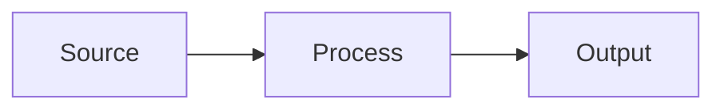

# [Project name]

**Type:** Enterprise project / Graduate coursework / Home lab
**Category:** Basic IT / Cybersecurity / Automation / Networking / Hardware / Software
**Tech:** languages, tools, platforms
**Status:** Complete / In progress

## Overview
What it is and the problem it solves, in plain language. 3–5 sentences.

## Architecture
Diagram (an image or a Mermaid block) plus a short explanation of the components.

## My role
What I personally did versus the team, especially for group or school projects.

## Implementation
Key steps, decisions, and trade-offs. Link the code in this folder.

## Results
Measurable outcomes, screenshots (sanitized), or a grade or feedback for academic work.

## How to run it / reproduce it
_(For code projects.)_ Prerequisites, setup, usage.

## What I'd do differently
Shows maturity. Keep it brief.
